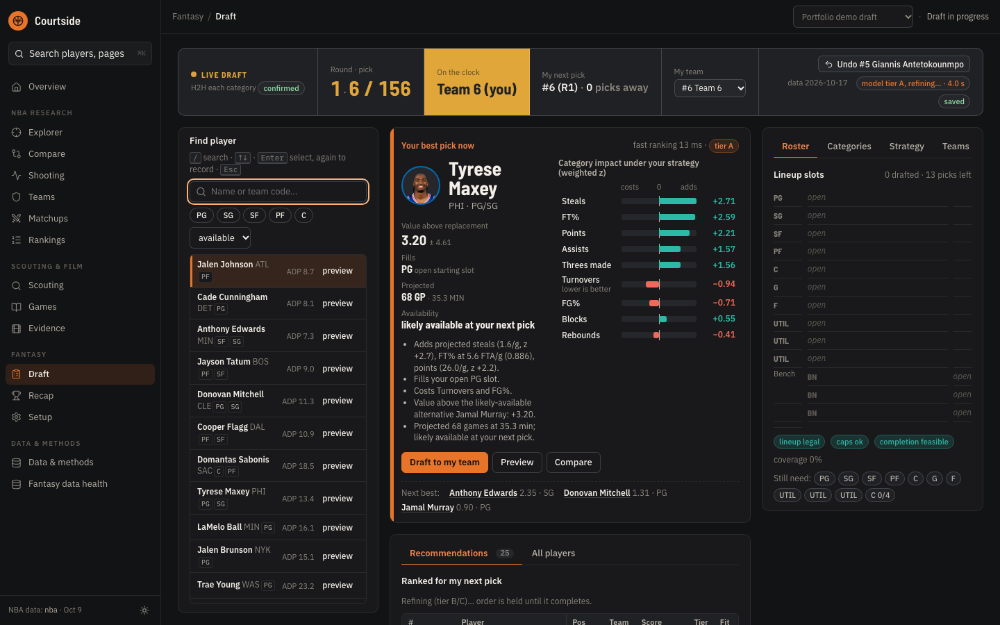
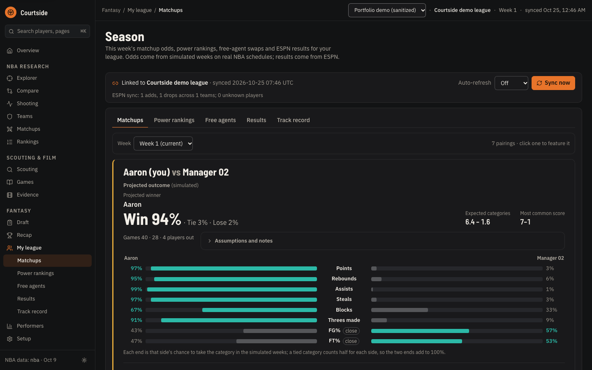
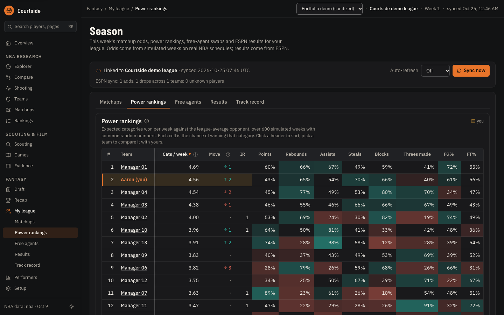
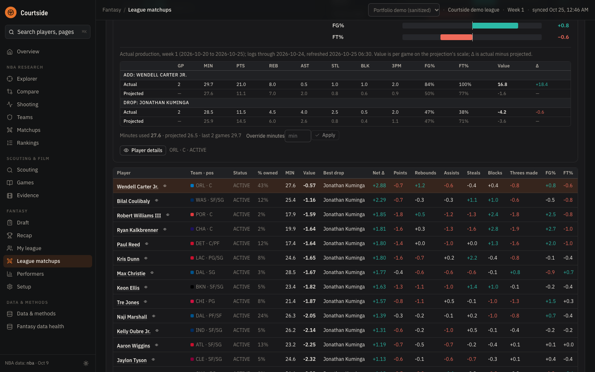
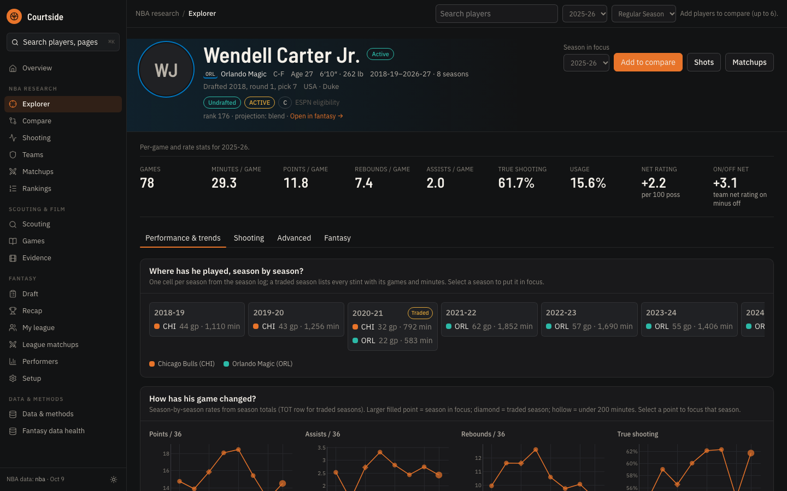
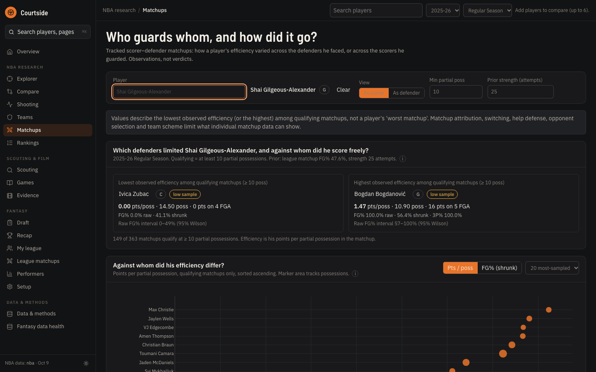
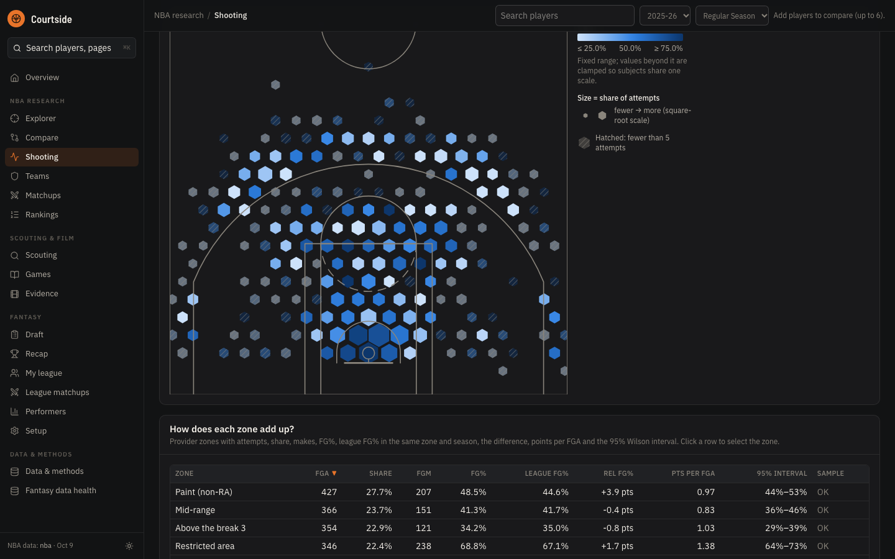
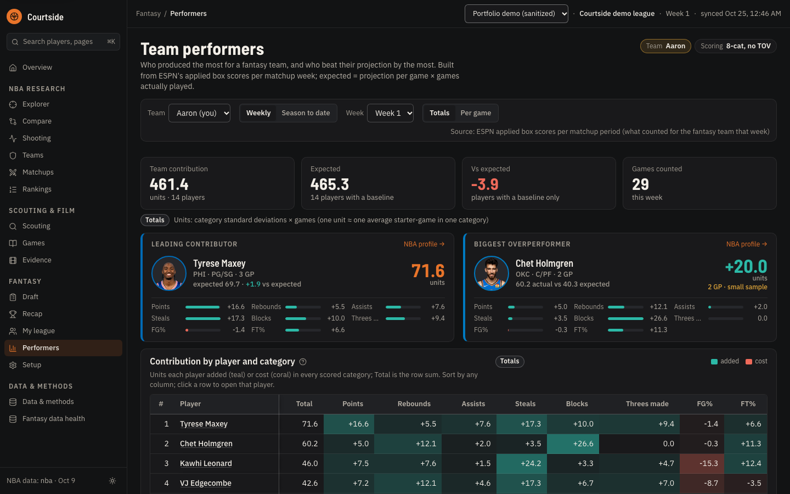

# Courtside

One local-first NBA workspace built from two earlier projects:

- **Analytics** (from `nba_advanced_statistics`): player/team research workbench. FastAPI + DuckDB
  over Parquet, React + Vite + Tailwind frontend. This frontend is now the main Courtside UI.
- **Fantasy** (from `fantasy_draft_simulator`): ESPN nine-category draft copilot and in-season
  companion (draft, recap, ESPN league link and sync, season odds, performers, CSV imports, session
  export/import). FastAPI + SQLite sessions + Parquet snapshots. Its UI is mounted unchanged inside
  the main frontend at `/fantasy`.

Nothing talks to the network on request paths; both services bind to localhost. The browser loads
player headshots and team logos from the public NBA/ESPN image CDNs (initials and tricodes are the
fallback when an image is unavailable).

## Demo

https://github.com/user-attachments/assets/db43b44b-a879-44b6-97f1-d34184eb0bfe

A 74-second tour: the research pages, a live draft with recommendations, then my league's matchups,
power rankings, free agents and performers. It runs against a copy of my own ESPN league for the
2026-27 season: real NBA players, the real schedule and this season's game logs, with every
manager, team and league name replaced. Pause and scrub; each screen stays up for a few seconds.
The same file is in the repo at [docs/media/courtside-demo.mp4](docs/media/courtside-demo.mp4), and
a short loop of the fantasy half is below.


| | |
|---|---|
| [](docs/media/shots/draft.png) **Draft copilot.** Value above replacement, category impact under your strategy, whether the player survives until your next pick, and the next-best alternatives. | [](docs/media/shots/league-matchup.png) **League matchups.** Simulated weeks on the real NBA schedule give a win chance per category, with ESPN's running totals underneath. |
| [](docs/media/shots/power-rankings.png) **Power rankings.** Expected categories won against the league-average opponent, and each team's chance in every category. | [](docs/media/shots/free-agents.png) **Free agents.** Each add ranked against your roster with the cheapest drop, actual vs projected lines, and in-season minutes with a per-player override. |
| [](docs/media/shots/player-profile.png) **Player profile.** Season-by-season stints, rate trends, shot zones and matchup history for any player. | [](docs/media/shots/matchups.png) **Matchups.** Tracked scorer–defender pairs: where a scorer's efficiency fell or rose, with sample-size caveats attached. |
| [](docs/media/shots/shooting-lab.png) **Shooting lab.** Hexbins, provider zones or raw markers; frequency and accuracy encoded separately with Wilson intervals. | [](docs/media/shots/performers.png) **Performers.** Who carried a fantasy team this week and who beat their projection, from ESPN's applied box scores. |

The demo is scripted and reproducible: `node frontend/scripts/demo-tour.mjs --session <id> --out <dir>`
drives the app with Playwright while `make dev` is running, records the video and takes one
screenshot per step; `--short` records only the fantasy highlights used for the GIF. Point it at a
session whose names are already pseudonymous. The MP4 and GIF were encoded with ffmpeg
(`libx264 -crf 24` and a 12 fps, 960 px palette GIF).

## The interface

One shell for both halves: a grouped sidebar (Overview · NBA research · Scouting & film · Fantasy ·
Data & methods), a toolbar that shows the NBA season picker and compare tray on research pages and
the fantasy session / league / week / last-sync on fantasy pages, and a ⌘K palette for players and
pages. Dark is the primary theme (toggle in the sidebar footer). Design tokens live in
`frontend/src/index.css` (`--c-*`, mirrored for the fantasy copilot in
`frontend/src/fantasy/styles/tokens.css`); the spec is
`docs/superpowers/specs/2026-10-24-courtside-redesign.md`.

- **Overview** (`/`): your matchup this week with per-category odds, power rank, projection track
  record, leading contributor and biggest overperformer, recently viewed players.
- **Player profile**: hero header with portrait and team colours, the copilot's eligibility /
  ownership / projection for the player when a session is open, stat tiles, tabs
  (Performance · Shooting · Advanced · Fantasy).
- **Fantasy performers**: feature cards, player × category contribution heatmap, totals / per-game
  toggle, and "NBA profile" links; the browser Back button returns to the same team and week.
- **Fantasy free agents**: rank by projection or by actual production (this week or season to date)
  once you press "Refresh game logs"; the swap panel shows add and drop actual vs projected.

## Layout

```
frontend/                 Courtside UI (React 19, Vite, Tailwind v4, Plotly, D3, TanStack)  :5173
frontend/src/fantasy/     the fantasy copilot UI, plain CSS, served at /fantasy
services/analytics/       analytics API (Python 3.13, uv)                                   :8001
services/fantasy/         fantasy API   (Python 3.12, uv)                                   :8002
data/analytics/           (gitignored) raw cache, Parquet, manifests, media, scouting.sqlite
data/fantasy/             demo + templates tracked; nba/ snapshots and sessions/ gitignored
docs/analytics/, docs/fantasy/   each project's docs, plus ORIGINAL_README.md / ORIGINAL_CLAUDE.md
exports/fantasy/          (gitignored) fantasy CLI exports
```

The two backends both ship a top-level Python package called `app`, so they keep **separate
virtual environments** (`services/*/.venv`) and are never imported together.

## Prerequisites

Python 3.12 and 3.13 via [uv](https://docs.astral.sh/uv/) (uv downloads them if missing), Node 20+
(tested on 24), `make`. `ffmpeg`/`ffprobe` are optional (analytics managed video).

## Run

```bash
make install   # uv sync in both services, npm ci in the frontend
make dev       # analytics :8001, fantasy :8002, Courtside UI :5173 — Ctrl-C stops all three
```

Open http://127.0.0.1:5173 for the analytics workbench and http://127.0.0.1:5173/fantasy for the
fantasy copilot (session ids stay in the URL as before: `/fantasy?session=<id>#/season`). Each
sidebar links to the other. Override ports with `make dev ANALYTICS_PORT=8011 FANTASY_PORT=8012 FRONTEND_PORT=5183`.

| Browser path          | Forwarded to                | As        |
| --------------------- | --------------------------- | --------- |
| `/api/analytics/*`    | `http://127.0.0.1:8001`     | `/api/*`  |
| `/api/fantasy/*`      | `http://127.0.0.1:8002`     | `/api/*`  |

The Vite dev server (`frontend/vite.config.ts`) rewrites the prefix; each service still serves its
original routes and response shapes (`/docs` on each port shows the OpenAPI schema). The analytics
UI calls `/api/analytics/...` through `src/lib/api.ts`; the fantasy UI has its own client
(`src/fantasy/api/client.ts`, base `/api/fantasy`, error format `{code, message, detail}`).

### How the fantasy UI is embedded

`frontend/src/fantasy` is the standalone copilot app copied verbatim and mounted full-screen at
`/fantasy` outside the analytics shell, so it keeps its charcoal sidebar, hash router and design
system. Its stylesheets are plain CSS; `vite.config.ts` prefixes every rule with `.fantasy-root` at
build time, `src/index.css` reverts Tailwind's preflight and utilities inside that container, and
Tailwind never scans `src/fantasy` for class names. Edit the copilot's CSS and components as before;
the only differences from the standalone app are the API base and a link back to the analytics
side. Regenerate its typed client with `make -C services/fantasy openapi`. Decision record:
`docs/fantasy/DECISIONS.md` (DEC-31).

## Data

- **Analytics** reads `data/analytics/{demo,nba}/` (override with `NBA_DATA_DIR` in
  `services/analytics/.env`). With a populated `nba` manifest the API serves the real namespace
  automatically. Regenerate the synthetic set with `make demo-data`; ingest real seasons with
  `make -C services/analytics ingest SEASONS="2024-25"`.
- **Fantasy** reads `data/fantasy/` (override with `COPILOT_DATA_DIR` in `services/fantasy/.env`):
  `sessions/sessions.sqlite` (draft sessions and event log), `nba/snapshots/` (projection
  snapshots), `nba/normalized/` (players, schedule, game logs), `nba/live/` (per-league ESPN sync),
  `nba/raw/` (provider cache), `demo/` and `templates/` (tracked fixtures). CLI docs it writes go to
  `docs/fantasy/`, exports to `exports/fantasy/`.
- Everything under `data/analytics/`, `data/fantasy/nba/`, `data/fantasy/sessions/` and
  `exports/` is gitignored.

## Configuration and secrets

Each service reads only its own `.env` (`services/analytics/.env`, `services/fantasy/.env`); see
the `.env.example` next to each. All `.env` files are gitignored. Optional private ESPN cookies
(`COPILOT_ESPN_SWID`, `COPILOT_ESPN_S2`) go in `services/fantasy/.env` only and are never logged,
exported or sent to the browser.

## Checks

```bash
make test                  # all of the below
make test-analytics        # pytest + coverage (services/analytics)
make test-fantasy          # pytest (services/fantasy)
make test-frontend         # vitest (analytics + fantasy UI) + tsc -b
make lint                  # ruff (both services) + oxlint (frontend)
make e2e                   # analytics Playwright smoke tests; needs `make dev` running
make e2e-fantasy           # fantasy Playwright suite; boots its own API (:8010) and Vite (:5175)
```

Service-specific commands (ingestion, snapshot builds, ESPN link/sync, benchmarks, evaluations)
live in `services/analytics/Makefile` and `services/fantasy/Makefile`; run them with
`make -C services/<name> <target>`.

## Not adapted yet

- `services/analytics/deploy/` (docker-compose files, Caddyfile) and the two Dockerfiles are
  copied verbatim from the analytics project and still assume the old `backend/` + `frontend/`
  layout. Local development does not use them.
- The two UIs are still two design systems (Tailwind dark/light workbench, plain-CSS light
  copilot) that share one app shell boundary at `/fantasy`; unifying them is a later phase.
