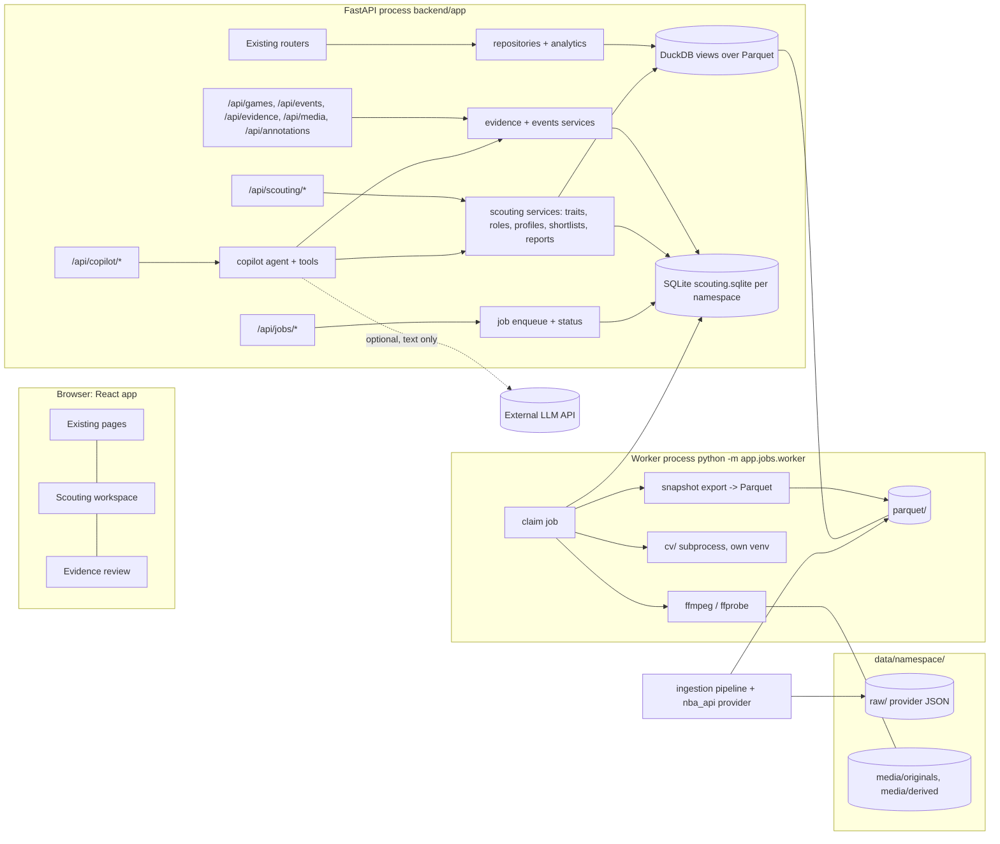
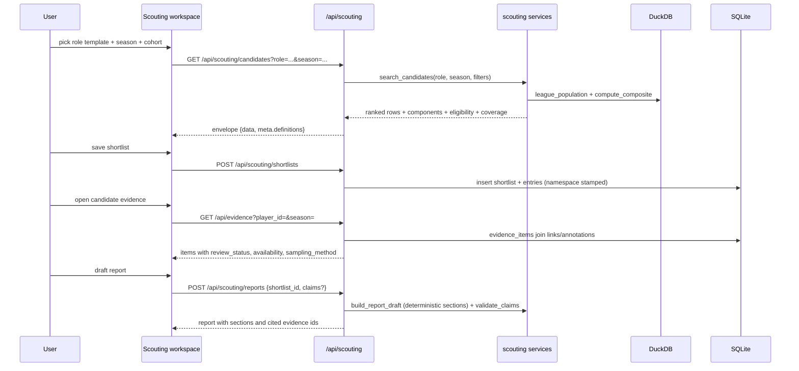
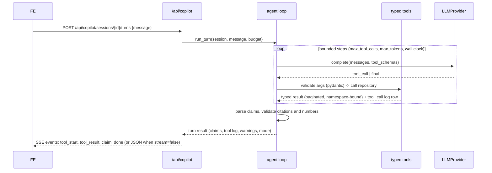

# Architecture

Canonical home for: proposed components, data flow, ownership boundaries, process topology, the
durable worker, runtime isolation for CV, and how new parts attach to the existing app. Entity
fields are in [DATA_MODEL.md](DATA_MODEL.md); media handling in [VIDEO_PIPELINE.md](VIDEO_PIPELINE.md);
agent internals in [COPILOT.md](COPILOT.md); decisions in [DECISIONS.md](DECISIONS.md).

## 1. Shape of the extended system



The browser talks only to `/api`. Only the ingestion pipeline talks to stats.nba.com. Only the
worker runs ffmpeg or CV. The LLM call, when enabled, is made by the API process and carries text.

## 2. Packages to add (ownership boundaries)

| Package | Owns | Depends on | Must not |
| --- | --- | --- | --- |
| `backend/app/state/` | SQLite connection factory, migrations runner, row-mapper helpers, per-namespace open/close | `config`, `data.paths` | know about media or agents |
| `backend/app/events/` | `games`, `events`, `event_participants`, `event_id_map` normalizers and fetchers (registered into `ingestion.fetchers.FETCHERS` and `pipeline.STEP_ORDER`), event query repository | `ingestion`, `data.schemas` | reach SQLite |
| `backend/app/evidence/` | media registry, uploads, storage keys, derivatives metadata, alignment anchors, segments, event-video links, annotations + revisions, evidence items, snapshot export | `state`, `events` repository | run ffmpeg inline (enqueue jobs instead) |
| `backend/app/jobs/` | `processing_jobs` table access, worker loop, lease/heartbeat, retry, cancellation, job handlers registry, inline runner for tests | `state`, handler modules | import torch |
| `backend/app/scouting/` | trait registry and computation, role templates, candidate search, profile snapshots, shortlists, report drafts and claim validation | `analytics`, `data.repositories`, `evidence` read API | duplicate metric formulas |
| `backend/app/copilot/` | `LLMProvider` protocol + providers, tool schemas, agent loop, session store, budgets, logging, evals runner | `scouting`, `evidence`, `events` through typed tools only | execute SQL or shell |
| `cv/` (separate uv project) | model interfaces, CLI entry points per task, evaluation scripts | its own deps | import `backend/app` |
| `frontend/src/pages/scouting/`, `pages/evidence/`, `pages/games/` | new pages and components | `lib/api`, `hooks`, `components` | call the provider or load media from arbitrary URLs |

Files stay small (200–400 lines), one responsibility each, following the existing layout.

## 3. Request paths

### Statistics -> shortlist -> evidence -> report (Phase C/D happy path)



### Media upload -> processing -> playback (Phase B)

```mermaid
sequenceDiagram
  participant FE
  participant API as /api/media
  participant ST as evidence.storage
  participant SQL as SQLite
  participant W as worker
  FE->>API: POST /api/media/uploads (multipart, size-limited)
  API->>ST: stream to temp, hash sha256, sniff container
  ST-->>API: existing asset? (dedupe by hash)
  API->>SQL: insert video_assets(status=registered) + source_permissions
  API->>SQL: insert processing_jobs(kind=probe_media, idempotency_key=asset:probe:v1)
  API-->>FE: 202 {asset_id, job_id}
  W->>SQL: claim job (lease)
  W->>W: ffprobe -> duration, fps, time base, codec, dimensions
  W->>SQL: update asset metadata; enqueue make_playback, make_thumbnails
  W->>W: ffmpeg to derived/<asset>/<version>/playback.mp4 (tmp then rename)
  W->>SQL: one transaction: derivative row + job done
  FE->>API: GET /api/media/{asset_id}/playback (Range requests)
  API-->>FE: 206 partial content from managed storage key
```

### Copilot turn (Phase D)



## 4. Process topology and lifecycle

- **API process** (`uvicorn app.main:app`): on startup resolves namespace (existing), opens
  `scouting.sqlite` for that namespace, applies pending migrations, stores the connection factory on
  `app.state.state_db`. On namespace change (`_make_on_complete`) it closes and reopens the
  per-namespace SQLite the same way it rebuilds `Database`.
- **Worker process** (`python -m app.jobs.worker --namespace nba`): long-running loop; one worker
  per namespace at a time (a `worker_lock` row with heartbeat prevents two). It opens the same
  SQLite file. It never opens DuckDB except for snapshot export jobs (read-only).
- **Inline mode** (`JOBS_INLINE=1`, default in tests): the API runs the handler in a daemon thread
  after commit, using the same job table so behaviour and tests are identical.
- **CV subprocess**: invoked by the worker with `uv run --project cv python -m cv.tasks.<task>
  --job <json>`; exit code and a JSON result file are the contract.
- **Shutdown**: worker releases leases on SIGTERM; unfinished jobs return to `queued` when the
  lease expires (restart recovery).

## 5. Durable worker design (supersedes reuse of `IngestionManager`)

Why not reuse `IngestionManager`: it keeps progress in memory, has no persistence, cancellation,
retry of a run, or multi-step jobs. It stays as-is for provider ingestion.

| Requirement | Mechanism |
| --- | --- |
| Persistent state | `processing_jobs` row per job (DATA_MODEL §11) with `status` in `queued, running, succeeded, failed, cancelled, partial` |
| Idempotency | `idempotency_key` unique per namespace (e.g. `asset:{id}:playback:v2`); enqueue returns the existing job |
| Lease / restart recovery | `locked_by`, `lease_until`; worker heartbeat extends; expired leases are re-queued with `attempt+1` |
| Retry / backoff | `attempt`, `max_attempts`, `next_run_at = now + min(cap, base * 2^attempt) + jitter` (same constants as the provider) |
| Cancellation | `cancel_requested` flag polled between steps and before each ffmpeg/CV call; subprocesses are terminated |
| Progress | `progress` (0–1) and `progress_note` columns; `GET /api/jobs/{id}` |
| Atomic publication | outputs written to `*.tmp` paths, then one SQLite transaction inserts output rows and sets `status`; a crash before commit leaves no visible partial output |
| Partial | job-level `partial` with `result_json` listing completed/failed units (mirrors manifest `partial`) |
| Bounded processing | per-kind wall-clock limit, input size limit, max frames; a job that exceeds limits fails with a clear `error` |
| Observability | `job_events` append-only table (started, heartbeat, step, failed, succeeded) |

Handlers (registered by `kind`): `probe_media`, `make_playback`, `make_thumbnails`,
`detect_shot_boundaries`, `export_snapshot`, `cv_shot_release`, `cv_detect_track` (later),
`capability_probe` (bounded provider probe; still goes through `StatsProvider` pacing).

## 6. Runtime isolation for CV (DEC-14)

```
cv/
  pyproject.toml        own python pin (3.11 or 3.12 as the chosen libraries require), torch/opencv/etc.
  cv/tasks/shot_release.py, detect_track.py, court_calibrate.py
  cv/io.py              reads job JSON, writes result JSON + Parquet, never imports app.*
  cv/eval/              held-out evaluation scripts; produce metrics JSON committed under docs/scouting/evals/
```

The worker checks `cv_runtime_available()` (venv exists, `--version` call succeeds) and exposes it
in `/api/meta/capabilities`. Absence disables CV job kinds with a visible reason; everything else
works.

## 7. Integration with the existing system

- **Families**: `games`, `events`, `event_participants`, `event_id_map` (Phase A), later
  `possessions`, `lineup_stints` (Phase F), `evidence_snapshots`, `annotation_snapshots` (Phase B
  export) are added to `schemas._SCHEMAS`; `pipeline.STEP_ORDER` gains `games`, `events` after
  `team_game_logs`; `FIRST_SEASON_START_YEAR` gains entries once verified.
- **Capabilities endpoint**: `GET /api/meta/capabilities` reports `ffmpeg`, `cv_runtime`,
  `llm_provider` (`none|fixture|anthropic`), `worker_alive`, `video_sources` (adapters configured).
  The frontend reads it once (like `useStatus`) and gates features.
- **Namespace**: every SQLite table has a `namespace` column even though the file is per namespace
  (defence in depth; enables a single-file export). API handlers filter by `app.state.namespace`.
- **Frontend state**: shortlist and copilot session ids live in the URL (`?shortlist=`, `?session=`);
  a small zustand store caches the active shortlist with a `namespace` field and the same
  `syncNamespace` reset the compare store uses.
- **Navigation**: `NAV` in `AppShell.tsx` gains `Scouting` (`/scouting`) and `Evidence`
  (`/evidence`); `routes.tsx` gains `scouting`, `scouting/shortlists/:shortlistId`,
  `evidence`, `evidence/:assetId`, `games/:gameId`.
- **Methodology page**: `SECTIONS` in `pages/methodology/sections.ts` gains `video-coverage`,
  `annotation-method`, `models`; docs mirrored in `docs/METHODOLOGY.md`.

## 8. Deployment assumptions

Two deployments exist (DEC-19): the user's Mac runs everything (ingestion, API, web, later the
worker) via `make dev`; a public Ubuntu VM runs the read-only analytics stack from
`docker-compose.prod.yml` behind Caddy, fed by `make sync-data`, with scouting routes disabled until
access control exists. Scouting development is local-first on one machine. `make dev` additionally starts the worker (`make worker`).
`docker-compose.yml` may gain a `worker` service that shares the `./data` volume; no cloud, no
object store, no queue broker. Backups are a copy of `data/<namespace>/` (SQLite in WAL mode:
copy after `PRAGMA wal_checkpoint(TRUNCATE)` or use the `sqlite3 .backup` command).

## 9. Failure behaviour summary

| Condition | Behaviour |
| --- | --- |
| No SQLite file yet | created on first open; migrations applied; empty tables |
| ffmpeg missing | uploads accepted and registered; derivative jobs fail fast with `error = "ffmpeg not available"`; UI shows "playback unavailable on this machine" |
| Worker not running | jobs stay `queued`; `/api/meta/capabilities.worker_alive=false`; UI shows a hint to run `make worker` |
| CV runtime missing | CV job kinds hidden; existing annotations unaffected |
| LLM key missing | copilot in `none` mode: tools callable through the UI, deterministic report sections only, banner states no model is running |
| External reference stale (provider page gone) | link keeps `availability = stale/unavailable` after a bounded re-check; reports citing it keep the citation with a stale flag |
| Namespace switch | SQLite reopened; frontend stores reset; URLs with ids from another namespace resolve to 404 with a clear message |
